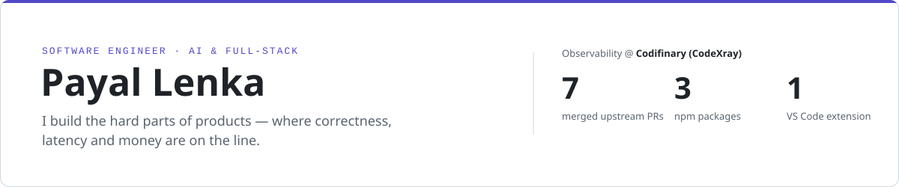
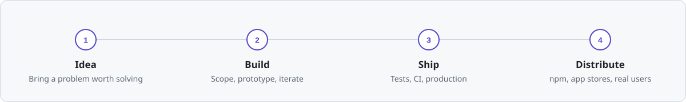

<picture>
  <source media="(prefers-color-scheme: dark)" srcset="assets/header-dark.svg">
  
</picture>

  
  
  
  
  
  

I'm a software engineer at **Codifinary (CodeXray)**, working on a production observability platform. Alongside that I build AI and product work for startups in the UK, US and Australia, contribute fixes to open-source infrastructure, and publish developer tools.

### Current focus

- **Observability** — traces, service maps, per-service execution breakdowns and p90 latency at CodeXray (Go, ClickHouse, React, OpenTelemetry)
- **Organisational memory for AI** — versioned document memory and a context graph across Notion, Slack, GitHub and Gmail, served to Claude agents (Qdrant, MCP, Langfuse)
- **AI in the delivery pipeline** — Claude Code review and test generation in CI across a dozen services
- **Open source** — fixing real bugs in CNCF, Red Hat and database ecosystems

### Published packages

| Package | Description |
|---|---|
| [**safety-label**](https://www.npmjs.com/package/safety-label) | Finds the tracker SDKs in an Android APK/AAB and drafts Google Play Data safety answers from vendors' own disclosures. Offline, zero dependencies; a CI mode fails builds that add a tracker. |
| [**npm-publish-doctor**](https://www.npmjs.com/package/npm-publish-doctor) | Audits a repository's npm release setup before 2FA-bypass tokens are retired, and prints the exact commands to move to trusted publishing (OIDC). Read-only. |
| [**interceptor-engine**](https://www.npmjs.com/package/interceptor-engine) | Real-time API and LLM observability — patches `fetch` to capture latency, cost and prompts. |
| [**Explain Code Simply**](https://marketplace.visualstudio.com/items?itemName=payallenka.explain-code-simply) | VS Code extension for AI-generated code explanations inside the editor. |

### Open-source contributions

| Project | Merged change |
|---|---|
| [Jaeger](https://github.com/jaegertracing/jaeger/pull/10049) (CNCF) | Cancel remote-storage trace streams when iteration stops early |
| [OpenTelemetry Collector Contrib](https://github.com/open-telemetry/opentelemetry-collector-contrib/pull/52761) | Oracle DB receiver: check `rows.Err` and close rows |
| [Keycloak](https://github.com/keycloak/keycloak/pull/55327) | Preserve a `$` that does not start a placeholder in `StringPropertyReplacer` |
| [Quarkus](https://github.com/quarkusio/quarkus/pull/58409) | Support negated predicates in MongoDB with Panache queries |
| [Quarkus](https://github.com/quarkusio/quarkus/pull/57990) | Apply `quarkus.devservices.timeout` to the JDBC wait of MySQL, MariaDB and MSSQL Dev Services |
| [Quarkus](https://github.com/quarkusio/quarkus/pull/58128) | Stop propagating default values from the Gradle build |
| [Debezium Spanner Connector](https://github.com/debezium/debezium-connector-spanner/pull/180) | Do not modify record headers in place when adding timestamps |

### Selected projects

| Project | Description |
|---|---|
| [**fde-order-intake-agent**](https://github.com/payallenka/fde-order-intake-agent) | An AI order-intake agent deployed into a distributor's existing systems: Odoo ERP, a reverse-engineered legacy stock tool and an SFTP price list |
| [**TrackerLens**](https://github.com/payallenka/trackerlens) | Android app that shows which tracking SDKs are inside installed apps and flags updates that add more. On-device, no internet permission |
| [**rollout**](https://github.com/payallenka/rollout) | Make a breaking change once and open pull requests on every repository that needs it |
| [**AgentHub**](https://github.com/payallenka/AgentHub) | Real-time collaborative AI dashboard with CRDT sync (Yjs), offline-first editing and a model proxy |
| [**Bookstore Microservices**](https://github.com/payallenka/Microservices) | Spring Cloud reference system: Eureka, Gateway, OpenFeign, per-service PostgreSQL with Flyway |
| [**Unbox**](https://github.com/payallenka/unbox) | Interactive virtual gifts with no backend — the entire gift is encoded in the link |

Other work

 

- **Obligo** — converts signed contracts into checks against business data; an LLM extracts obligations, deterministic code evaluates them with evidence
- **Orbit** — durable, event-sourced runtime for AI agents in Go; interrupted runs resume without repeating work
- **Runscan** — critical-path analysis of AI agent traces to explain latency and cost
- **FlakeGuard** — CI reliability analytics that rank flaky tests by engineering time lost
- **Jarvis Mobile** — assistant whose memory stays on an Android phone while inference runs on paired hosts
- **[ScholarshipHub](https://github.com/payallenka/ScholarshipScraping)** — aggregates ten scholarship sources into one schema with LLM-based matching

### Tech stack

- **Languages** — Go · TypeScript · Python · Java · Kotlin
- **AI** — Claude · OpenAI · MCP · Qdrant · Langfuse · Ollama
- **Backend & data** — Node.js · Spring Boot · Quarkus · PostgreSQL · MongoDB · ClickHouse · OpenTelemetry
- **Frontend** — React · Next.js · Tailwind CSS
- **Infrastructure** — Docker · Kubernetes · AWS · GitHub Actions

### Background

- Software Developer, Codifinary (CodeXray)
- Paper accepted at ICWITE 2026
- Contributor to a patent-backed project
- Former GDSC Core member and IEEE Student Chapter Chair
- 250+ LeetCode problems · CodeChef 3★

### Working together

I'm open to collaborations, freelance projects and new ideas — taking them from a first conversation through to build, launch and distribution.

<picture>
  <source media="(prefers-color-scheme: dark)" srcset="assets/process-dark.svg">
  
</picture>

Reach me at **[payalm.lenka@gmail.com](mailto:payalm.lenka@gmail.com)** · [Portfolio](https://payallenka.vercel.app) · [Lenkara Studio](https://lenkara.vercel.app) · [LinkedIn](https://www.linkedin.com/in/payallenka/)
