

  <a href="https://payallenka.vercel.app"></a>

  
  
  
  
  
  

 


  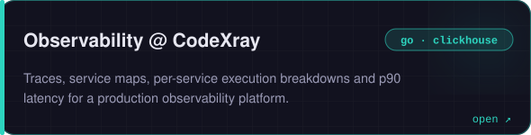
  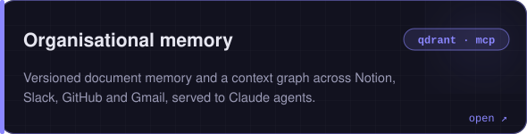
  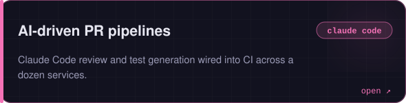
  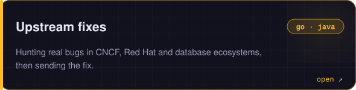


  <a href="https://www.npmjs.com/package/safety-label"></a>
  <a href="https://www.npmjs.com/package/npm-publish-doctor"></a>
  <a href="https://www.npmjs.com/package/interceptor-engine"></a>

also on the VS Code Marketplace → <a href="https://marketplace.visualstudio.com/items?itemName=payallenka.explain-code-simply"><b>Explain Code Simply</b></a>


<a href="https://github.com/pulls?q=is%3Apr+author%3Apayallenka+is%3Amerged+-user%3Apayallenka+-org%3ACodifinary+-org%3ALaxsisTechnologies"></a>

  <a href="https://github.com/jaegertracing/jaeger/pull/10049">jaeger</a> ·
  <a href="https://github.com/open-telemetry/opentelemetry-collector-contrib/pull/52761">opentelemetry</a> ·
  <a href="https://github.com/keycloak/keycloak/pull/55327">keycloak</a> ·
  <a href="https://github.com/quarkusio/quarkus/pull/58409">quarkus</a> ·
  <a href="https://github.com/quarkusio/quarkus/pull/57990">quarkus</a> ·
  <a href="https://github.com/quarkusio/quarkus/pull/58128">quarkus</a> ·
  <a href="https://github.com/debezium/debezium-connector-spanner/pull/180">debezium</a>

  <a href="https://github.com/payallenka/fde-order-intake-agent">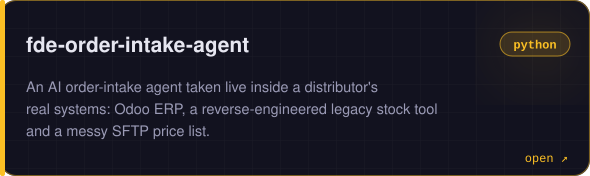</a>
  <a href="https://github.com/payallenka/trackerlens">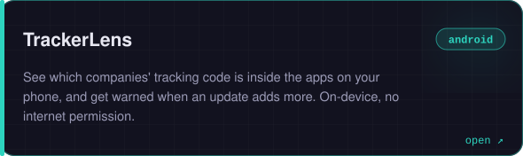</a>
  <a href="https://github.com/payallenka/rollout">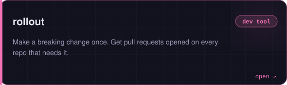</a>
  <a href="https://github.com/payallenka/AgentHub">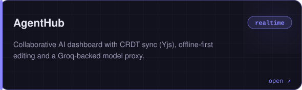</a>
  <a href="https://github.com/payallenka/unbox">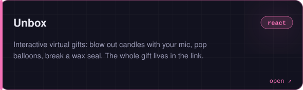</a>
  <a href="https://github.com/payallenka/Microservices">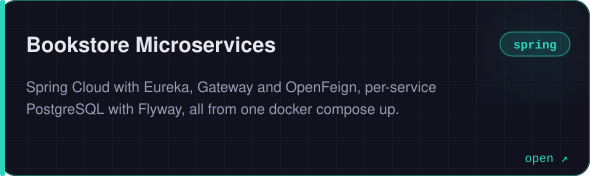</a>

<b>&nbsp;+ more experiments & prototypes</b>

 

| | |
|---|---|
| **Obligo** | Signed contracts → checks against real business data. An LLM extracts obligations; deterministic code decides breach / at-risk / compliant, with evidence |
| **Orbit** | Durable, event-sourced runtime for AI agents in Go — crashed runs resume without repeating work |
| **Runscan** | Critical-path analysis of AI agent traces: why a run was slow and where the money went |
| **FlakeGuard** | CI reliability intelligence — rank flaky tests by engineer-hours lost |
| **Jarvis Mobile** | Assistant whose memory lives on your Android phone; thinking runs on any paired computer |
| **[ScholarshipHub](https://github.com/payallenka/ScholarshipScraping)** | 10 scholarship sources, one schema, an LLM-personalised shortlist |
| **GridMind** | AI operations prototype for data-centre power and cooling |
| **Askly · Slotly** | A cited, document-grounded business assistant · multi-tenant booking SaaS |


   
  

  
  
  
  
  
  
  
  
  

  💼 Software Developer @ <b>Codifinary (CodeXray)</b> · 📄 paper accepted at <b>ICWITE 2026</b> · 🔬 patent-backed project 
  👩‍💻 ex <b>GDSC Core</b> · ex <b>IEEE Student Chapter Chair</b> · 🧩 <b>250+ LeetCode</b> · <b>CodeChef 3★</b>


<a href="mailto:payalm.lenka@gmail.com"></a>

  <b>Have an idea that deserves to exist? A tool that should be shipped? A product that needs real users?</b> 
  I'm open to collaborations, freelance work and new ideas — from the first sketch to build, launch and distribution.

  
  

<i>I'd rather ship one real thing than a hundred demos.</i>

